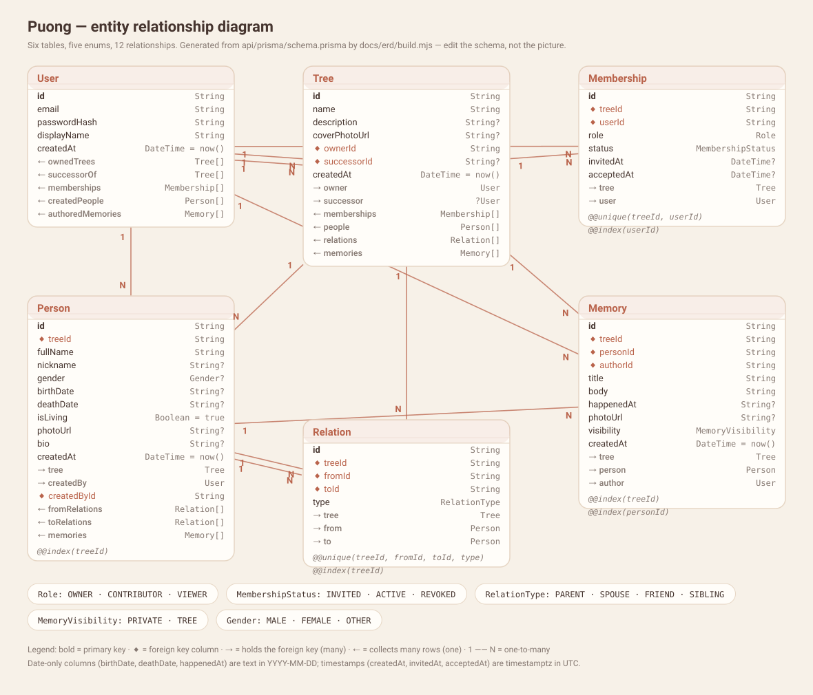

# ERD — Puong data model

Generated from `api/prisma/schema.prisma` by `docs/erd/build.mjs`, so it describes the database that actually exists rather than one a diagram remembered.



Regenerate with:

```bash
node docs/erd/build.mjs
```

## Models

### User

| Column | Type | Notes |
|---|---|---|
| `id` | `String` | **primary key** · default `cuid()` |
| `email` | `String` | **unique** |
| `passwordHash` | `String` | — |
| `displayName` | `String` | — |
| `createdAt` | `DateTime` | default `now()` |
| ownedTrees | `Tree[]` | relation (one side) |
| successorOf | `Tree[]` | relation (one side) |
| memberships | `Membership[]` | relation (one side) |
| createdPeople | `Person[]` | relation (one side) |
| authoredMemories | `Memory[]` | relation (one side) |

### Tree

| Column | Type | Notes |
|---|---|---|
| `id` | `String` | **primary key** · default `cuid()` |
| `name` | `String` | — |
| `description` | `String?` | nullable |
| `coverPhotoUrl` | `String?` | nullable |
| `ownerId` | `String` | foreign key → `User` |
| `successorId` | `String?` | foreign key → `User` · nullable |
| `createdAt` | `DateTime` | default `now()` |
| owner | `User` | relation (many side) · onDelete **Restrict** |
| successor | `User?` | relation (many side) · onDelete **SetNull** |
| memberships | `Membership[]` | relation (one side) |
| people | `Person[]` | relation (one side) |
| relations | `Relation[]` | relation (one side) |
| memories | `Memory[]` | relation (one side) |

### Membership

| Column | Type | Notes |
|---|---|---|
| `id` | `String` | **primary key** · default `cuid()` |
| `treeId` | `String` | foreign key → `Tree` |
| `userId` | `String` | foreign key → `User` |
| `role` | `Role` | — |
| `status` | `MembershipStatus` | — |
| `invitedAt` | `DateTime?` | nullable |
| `acceptedAt` | `DateTime?` | nullable |
| tree | `Tree` | relation (many side) · onDelete **Cascade** |
| user | `User` | relation (many side) · onDelete **Cascade** |
| *@@unique* | — | `treeId`, `userId` |
| *@@index* | — | `userId` |

### Person

| Column | Type | Notes |
|---|---|---|
| `id` | `String` | **primary key** · default `cuid()` |
| `treeId` | `String` | foreign key → `Tree` |
| `fullName` | `String` | — |
| `nickname` | `String?` | nullable |
| `gender` | `Gender?` | nullable |
| `birthDate` | `String?` | nullable |
| `deathDate` | `String?` | nullable |
| `isLiving` | `Boolean` | default `true` |
| `photoUrl` | `String?` | nullable |
| `bio` | `String?` | nullable |
| `createdAt` | `DateTime` | default `now()` |
| tree | `Tree` | relation (many side) · onDelete **Cascade** |
| createdBy | `User` | relation (many side) · onDelete **Restrict** |
| `createdById` | `String` | foreign key → `User` |
| fromRelations | `Relation[]` | relation (one side) |
| toRelations | `Relation[]` | relation (one side) |
| memories | `Memory[]` | relation (one side) |
| *@@index* | — | `treeId` |

### Relation

| Column | Type | Notes |
|---|---|---|
| `id` | `String` | **primary key** · default `cuid()` |
| `treeId` | `String` | foreign key → `Tree` |
| `fromId` | `String` | foreign key → `Person` |
| `toId` | `String` | foreign key → `Person` |
| `type` | `RelationType` | — |
| tree | `Tree` | relation (many side) · onDelete **Cascade** |
| from | `Person` | relation (many side) · onDelete **Cascade** |
| to | `Person` | relation (many side) · onDelete **Cascade** |
| *@@unique* | — | `treeId`, `fromId`, `toId`, `type` |
| *@@index* | — | `treeId` |

### Memory

| Column | Type | Notes |
|---|---|---|
| `id` | `String` | **primary key** · default `cuid()` |
| `treeId` | `String` | foreign key → `Tree` |
| `personId` | `String` | foreign key → `Person` |
| `authorId` | `String` | foreign key → `User` |
| `title` | `String` | — |
| `body` | `String` | — |
| `happenedAt` | `String?` | nullable |
| `photoUrl` | `String?` | nullable |
| `visibility` | `MemoryVisibility` | — |
| `createdAt` | `DateTime` | default `now()` |
| tree | `Tree` | relation (many side) · onDelete **Cascade** |
| person | `Person` | relation (many side) · onDelete **Cascade** |
| author | `User` | relation (many side) · onDelete **Restrict** |
| *@@index* | — | `treeId` |
| *@@index* | — | `personId` |

## Relationships

| # | From (one) | To (many) | Foreign key | On delete | Meaning |
|---|---|---|---|---|---|
| 1 | `User` | `Tree` | `ownerId` | Restrict | User has many trees |
| 2 | `User` | `Tree` | `successorId` | SetNull | User has many trees |
| 3 | `Tree` | `Membership` | `treeId` | Cascade | Tree has many memberships |
| 4 | `User` | `Membership` | `userId` | Cascade | User has many memberships |
| 5 | `Tree` | `Person` | `treeId` | Cascade | Tree has many persons |
| 6 | `User` | `Person` | `createdById` | Restrict | User has many persons |
| 7 | `Tree` | `Relation` | `treeId` | Cascade | Tree has many relations |
| 8 | `Person` | `Relation` | `fromId` | Cascade | Person has many relations |
| 9 | `Person` | `Relation` | `toId` | Cascade | Person has many relations |
| 10 | `Tree` | `Memory` | `treeId` | Cascade | Tree has many memorys |
| 11 | `Person` | `Memory` | `personId` | Cascade | Person has many memorys |
| 12 | `User` | `Memory` | `authorId` | Restrict | User has many memorys |

## Enums

- **Role** — `OWNER`, `CONTRIBUTOR`, `VIEWER`
- **MembershipStatus** — `INVITED`, `ACTIVE`, `REVOKED`
- **RelationType** — `PARENT`, `SPOUSE`, `FRIEND`, `SIBLING`
- **MemoryVisibility** — `PRIVATE`, `TREE`
- **Gender** — `MALE`, `FEMALE`, `OTHER`

## Why these relations

The reasoning behind many-to-many `User ↔ Tree` (through `Membership`) and one-to-many `Tree → Person` is in `PROPOSAL.md` ("Why these relations") and restated for M2 in `MILESTONES.md`. Two constraints worth reading here:

- `@@unique([treeId, userId])` on `Membership` is what makes "the same person cannot be invited twice" a database fact rather than a check in a service.

- `@@unique([treeId, fromId, toId, type])` on `Relation` is what makes "the same link cannot be created twice" a 409 instead of a duplicate row.

- `Person.treeId` and `Relation.treeId` both cascade from `Tree`, so deleting a tree removes a whole family record in one statement instead of a list of deletes that could be forgotten.

