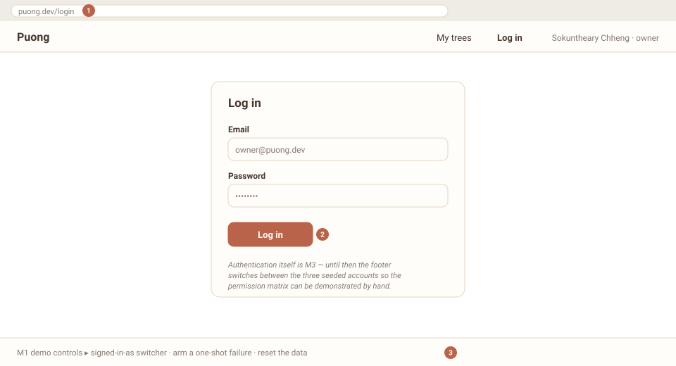
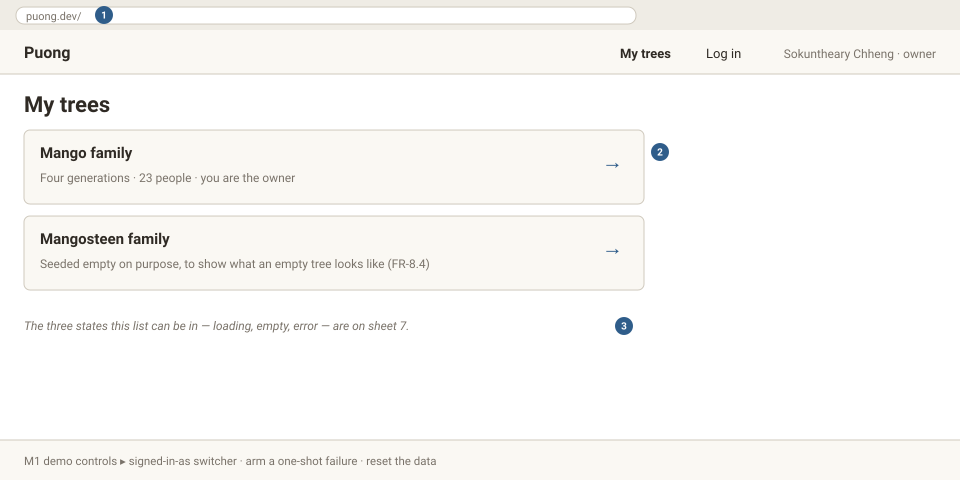
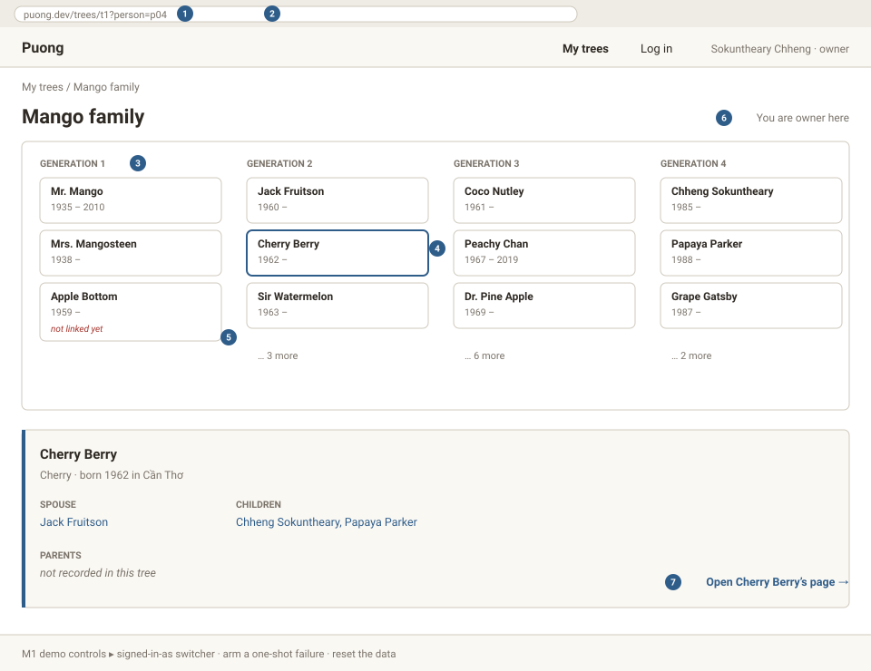
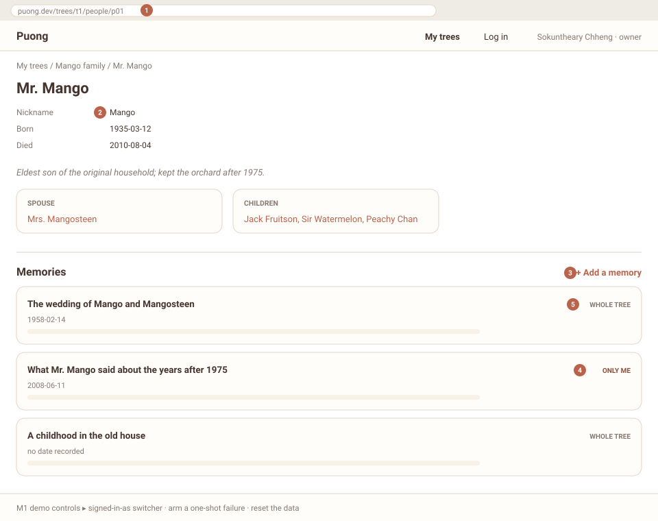
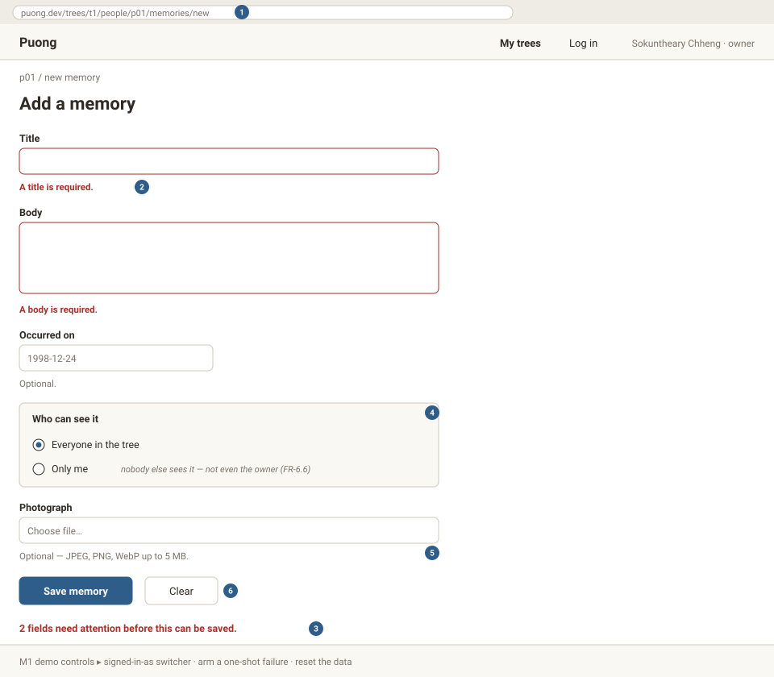
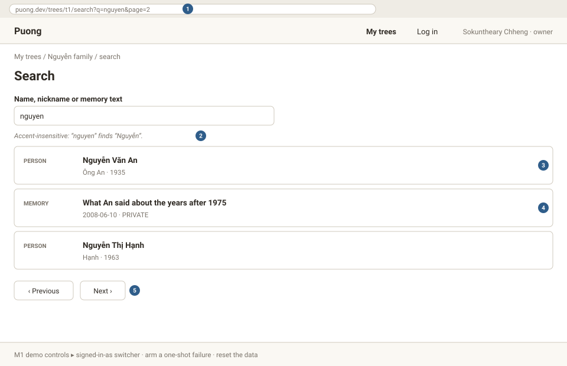

# M1 — wireframes of the main screens

| Field | Value |
|---|---|
| **Milestone** | M1 — Frontend prototype (week 5) |
| **Checklist item** | *Wireframes (photo or tool) of the main screens in `docs/`* |
| **Date** | 24 October 2026 |
| **Author** | Chheng Sokuntheary · p20240044 |
| **Source** | the six routes in `docs/design.md` §3 |
| **Regenerate** | `node docs/wireframes/build.mjs` |

Seven low-fidelity sheets — six screens plus one showing the states every list can be in.
They are drawn from the route table rather than traced from the build, because a wireframe
records structure and states: what is on the screen, which parts are route state, and what
happens when a request loads, returns nothing or fails. The finished pixels are the app's
own business; these are the decisions underneath them.

The numbered discs on each sheet are keyed to the notes below.

| # | Screen | Route | Route param | Sheets the checklist asks for |
|---|---|---|---|---|
| 1 | Login | `/login` | — | scaffolding for M3 |
| 2 | Home — my trees | `/` | — | ✓ |
| 3 | Family-tree canvas | `/trees/:treeId` | `treeId` | ✓ **detail page with a route parameter** |
| 4 | Person page | `/trees/:treeId/people/:personId` | `treeId`, `personId` | ✓ second parameterised route |
| 5 | Memory form | `/trees/:treeId/people/:personId/memories/new` | `treeId`, `personId` | ✓ **form with client-side validation** |
| 6 | Search | `/trees/t1/search` | `treeId` | ✓ stretch feature |
| 7 | Loading / empty / error | (any list) | — | ✓ **loading, empty and error states visible** |

---

## 1. Login

1. **`/login`** — the route. Authentication itself lands at M3; until then the footer
   switches between the three seeded accounts, which is what makes the permission matrix
   demonstrable rather than merely asserted.
2. **The login form.** Email and password. Client-side validation on *this* form arrives
   with M3 — the M1 checklist's validated form is sheet 5.
3. **M1 scaffolding in the footer**: the account switcher, a one-shot failure trigger and a
   data reset. All three disappear when there is a real session to sign in with.

---

## 2. Home — my trees

1. **`puong.dev/`** — route `/`, no parameter.
2. **One card per tree** → `/trees/:treeId`. The member sees the trees they belong to
   (FR-1.2, FR-1.3). The second tree is seeded empty on purpose, so the empty state of
   sheet 7 has a screen that reaches it (FR-8.4).
3. **Pointer to sheet 7** — this same list in its loading, empty and error states.

---

## 3. Family-tree canvas

1. **`treeId` in the path** — the M1 checklist's detail page with a route parameter.
2. **`?person=p04`** — the selected person is *route* state, not store state: it must
   survive a refresh, work with the back button and be sendable as a link
   (`design.md` §3). Selecting a card is a route push, so the URL and the screen cannot
   disagree.
3. **Generation columns**, placed by the rule in `design.md` §1 / FR-5.6: a parentless
   person starts at 0, a child sits one below the highest of their parents, and the two
   steps repeat until stable. `scripts/check-generations.mjs` asserts the resulting
   counts, and the app computes the identical layout.
4. **Selected card** — accent outline and `aria-pressed`, so the selection is visible to a
   screen reader, not only to the eye.
5. **"not linked yet"** — a person with no relations at all. Story 5 exists to fix exactly
   this, and person `p23` (Hoàng Thị Bé) is the fixture that keeps the flag from being
   dead code.
6. **Role line** — FR-3.6. A viewer sees *"you can read, not write"* here and is not
   offered any write control anywhere on the screen.
7. **The panel links to the detail page** rather than opening a modal: the person's own
   URL is the thing worth having, and a modal would throw it away.

---

## 4. Person page

1. **Two route parameters** — `treeId` and `personId`. A person is only meaningful inside
   one tree, so both are needed to fetch anything.
2. **Facts** — nickname, birth, death. Unknown values read *"not recorded"* rather than
   showing a blank, because a blank cannot be distinguished from a field that failed to
   load.
3. **"+ Add a memory"** appears only when the signed-in member's role permits writing
   (FR-3.6). A viewer is shown the reason instead of a link that would fail on submit.
4. **Visibility label** — a `PRIVATE` memory renders as *"only me"* for its author
   (FR-6.6). For anybody else the row is simply absent; the service never returns it, so
   the view cannot leak it by forgetting to filter.
5. **Memory list** ordered by occurred date, newest first, undated last (FR-6.7). With no
   memories the panel says so, naming the person, rather than showing an empty box.

---

## 5. Memory form, with validation

1. **Nested route** — `/memories/new` hangs off the person, because a memory always
   belongs to one and the person must be known before the form opens.
2. **Errors appear after a submit or a blur, never before**, and clear as soon as the
   value becomes acceptable (`design.md` §4). Flagging a required title before the user
   has typed is what makes a form feel like it is scolding you.
3. **A failed submit** moves focus to the first field that is wrong and announces the
   count through `role="alert"`, so the problem is heard as well as seen.
4. **Visibility** — `TREE` (the default) or `PRIVATE`, FR-6.6.
5. **Photograph** — optional, and when present JPEG, PNG or WebP up to 5 MB (FR-6.2). The
   title and body are required (FR-6.1); no length limit is imposed, because the
   specification sets none for memories.
6. **Save disables while the request is in flight** and reads "Saving…": the write has a
   loading state too, not only the reads.

---

## 6. Search (stretch feature)

1. **`?q=` and `?page=` are route state** — a search is worth nothing as a link if the
   link does not reproduce it, and a refresh must not lose the results
   (`design.md` §3). Typing rewrites the URL with `replace`, so one entry per keystroke
   does not bury the back button.
2. **Accent- and case-insensitive matching** — "nguyen" finds "Nguyễn". A Vietnamese name
   typed on a keyboard without diacritics has to be findable, or the search does not work
   for the family it is for.
3. **A result opens the person it belongs to.** A memory has no page of its own yet, so
   its hit opens the person whose memory it is.
4. **FR-6.6 applies to search exactly as it does to listing** — a `PRIVATE` memory is a
   hit only for its author, so search cannot be used to find what the list will not show.
5. **Pagination** — the chosen stretch feature; the page number rides in the URL and a
   page past the end clamps to the last.

---

## 7. Loading, empty and error

1. **Loading** — announced with `role="status"` and `aria-live="polite"`, because it is
   an update rather than a problem. The previous data is kept during a refetch instead of
   being swapped for a spinner, so the view does not jump under the reader's eyes.
2. **Empty** — the copy is passed in per screen, because "nothing to show" means no trees
   here, no people in that tree, no memories for this person, no matches for that query.
   One generic "no data" would say nothing.
3. **Error** — `role="alert"`, the message names what failed, and **Try again** reruns the
   same request. An error a user cannot act on is just a dead end with better manners.
4. **Idle renders nothing.** A fourth state, distinct from loading: a route can render
   before anything has been requested, and a view that treats idle as loading spins for
   data nobody asked for.

---

### How these were produced

`docs/wireframes/build.mjs` emits the seven SVGs from the route table in
`docs/design.md` §3, so the drawings cannot drift away from the routes the way a loose
sketch in a folder can; rerunning it reproduces them byte for byte. SVG rather than PNG
because it stays sharp at any zoom, prints cleanly, and stays reviewable as text in a
repository. Every number, count and rule shown here is the one the build and
`npm run check` assert: four generation columns of 3 / 6 / 9 / 5, twenty-three people, the
1958 / 1970 / 2008 memory order, and the two seeded trees.
